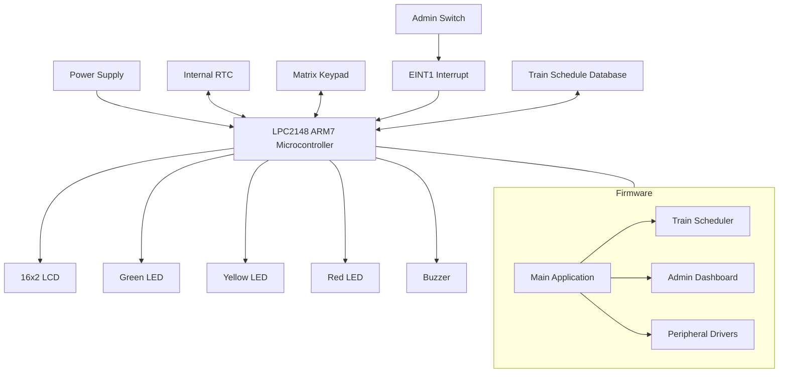
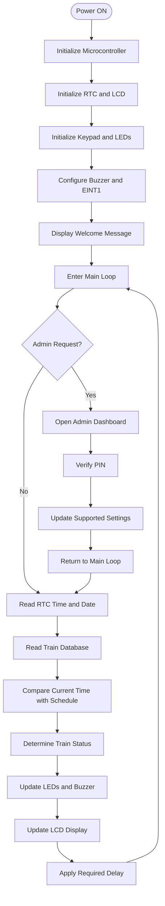
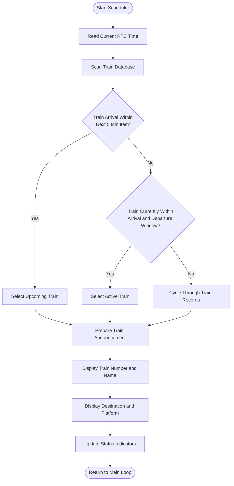
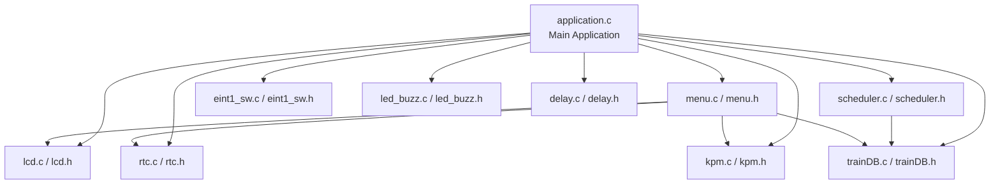

# smart-railway-announcement-controller
An embedded systems project using ARM7 LPC2148 to manage railway platform time display and train arrival/departure announcements using RTC, LCD, keypad, interrupt handling, LEDs, and buzzer.

# 🚆 Smart Railway Platform Controller

An embedded systems project that simulates a smart railway platform information and announcement system using the **LPC2148 ARM7 microcontroller**. It integrates a Real-Time Clock (RTC), 16×2 LCD, matrix keypad, train schedule database, administrator dashboard, status LEDs, and a buzzer.

**Project Type:** Embedded Systems / Embedded C
**Microcontroller:** LPC2148 (ARM7)
**Programming Language:** Embedded C
**Development Environment:** Keil µVision
**Display:** 16×2 Character LCD

---

## 📌 1. Project Overview

The Smart Railway Platform Controller displays real-time clock information, train schedules, arrival and departure times, platform numbers, and train status on an LCD.

The system uses the LPC2148 microcontroller to process train schedules and compare them with RTC time. Based on the schedule, it displays train announcements and controls status LEDs and a buzzer.

An administrator can access a configuration menu through an external interrupt switch and use the keypad to enter a PIN and modify supported settings.

This project demonstrates embedded programming, peripheral interfacing, interrupt handling, RTC operation, LCD communication, keypad scanning, and real-time schedule processing.

## ✨ 2. Features

* Displays current time in `HH:MM:SS` format.
* Displays the date in `DD/MM/YYYY` format.
* Displays train numbers, names, destinations, and platform numbers.
* Scrolls long train names and destination text on the LCD.
* Maintains train schedule records in firmware.
* Checks arrival and departure times using RTC data.
* Provides an administrator dashboard with PIN verification.
* Uses an external interrupt for administrator access.
* Supports configuration of train information and RTC values.
* Indicates train status through LEDs.
* Uses a buzzer for train-arrival indication.

## 🧰 3. Technologies Used

| Component            | Technology                         |
| -------------------- | ---------------------------------- |
| Microcontroller      | LPC2148 ARM7                       |
| Programming Language | Embedded C                         |
| IDE                  | Keil µVision                       |
| Display              | 16×2 LCD                           |
| Timekeeping          | Internal RTC                       |
| Input                | Matrix keypad and interrupt switch |
| Indicators           | LEDs and buzzer                    |
| Architecture         | ARM7                               |
| Firmware             | Modular C source and header files  |

---

## 🧱 4. System Block Diagram

The following diagram illustrates the overall system architecture.



### Block Diagram Description

* **LPC2148:** Controls the complete system and processes train schedules.
* **RTC:** Provides time and date information.
* **LCD:** Displays clock information and train announcements.
* **Keypad:** Accepts administrator input and menu selections.
* **Admin Switch:** Generates an external interrupt to request administrator access.
* **Train Database:** Stores train numbers, names, destinations, schedules, and platform information.
* **LEDs:** Indicate train status.
* **Buzzer:** Provides an audible indication when a train arrives.

---

## ⚙️ 5. System Working Flowchart

The flowchart below represents the main firmware execution sequence.



### Flowchart Explanation

1. The microcontroller initializes all required peripherals.
2. A welcome message appears on the LCD.
3. The program enters its continuous main loop.
4. If an administrator request is detected, the configuration dashboard is opened.
5. Otherwise, the current RTC time and date are read.
6. Train schedules are compared with the current time.
7. The program determines the appropriate train status.
8. LEDs and the buzzer are controlled according to the status logic.
9. The LCD displays clock information or train announcements.
10. The process repeats continuously.

---

## 🚉 6. Train Announcement Flowchart

The train scheduler evaluates the current time and selects the appropriate train information for display.



### Train Status Indicators

| Condition            | Expected Indication                 |
| -------------------- | ----------------------------------- |
| Train is on schedule | Green LED                           |
| Train is approaching | Yellow LED                          |
| Train is delayed     | Red LED                             |
| Train has arrived    | Arrival indication and buzzer pulse |

The exact LED and buzzer behavior depends on the implemented firmware logic and hardware wiring.

---

## 🔌 7. Hardware Interface Details

The following pin assignments are based on the project's peripheral definitions. Verify them against your final circuit and board configuration before connecting the hardware.

| Peripheral     | Pin / Interface      | Purpose                               |
| -------------- | -------------------- | ------------------------------------- |
| LCD Data Bus   | P0.6–P0.13           | Transfers LCD commands and characters |
| LCD RS         | P0.17                | Selects command or data register      |
| LCD EN         | P0.18                | Enables LCD data transfer             |
| LCD RW         | P0.19                | Controls LCD read/write operation     |
| Admin Switch   | P0.3 / EINT1         | Requests administrator access         |
| Keypad Rows    | P1.16–P1.19          | Scans keypad rows                     |
| Keypad Columns | P1.20–P1.23          | Detects keypad input                  |
| Status LEDs    | P1.27, P1.28, P1.29  | Indicates train status                |
| Buzzer         | P1.26                | Provides an audible indication        |
| RTC            | Internal LPC2148 RTC | Maintains time and date               |

**Note:** Confirm the pin mappings in `all_peripheral_defines.h` and the actual circuit schematic. Do not rely solely on comments in older source files.

---

## 🖥️ 8. Software Architecture Diagram

The project uses a modular architecture, with separate source and header files for different peripherals and application functions.



### Module Responsibilities

| Module                       | Responsibility                                      |
| ---------------------------- | --------------------------------------------------- |
| `application.c`              | Initializes peripherals and runs the main loop      |
| `rtc.c`, `rtc.h`             | Provides RTC initialization and time/date access    |
| `lcd.c`, `lcd.h`             | Handles LCD commands, characters, and strings       |
| `kpm.c`, `kpm.h`             | Scans the keypad and reads user input               |
| `scheduler.c`, `scheduler.h` | Processes train schedules and display timing        |
| `trainDB.c`, `trainDB.h`     | Stores train records and status definitions         |
| `menu.c`, `menu.h`           | Implements administrator menus and PIN verification |
| `eint1_sw.c`, `eint1_sw.h`   | Configures and handles the EINT1 interrupt          |
| `led_buzz.c`, `led_buzz.h`   | Controls status LEDs and the buzzer                 |
| `delay.c`, `delay.h`         | Provides delay routines                             |
| `all_peripheral_defines.h`   | Contains peripheral definitions and pin mappings    |
| `types.h`                    | Defines project-specific data types                 |
| `Startup.s`                  | Provides startup and exception-vector support       |

---

## 🚆 9. Sample Train Database

The firmware contains train records used by the scheduler.

| Train Number | Train Name        | Destination | Arrival | Departure | Platform |
| ------------ | ----------------- | ----------- | ------- | --------- | -------- |
| 12627        | Karnataka Express | New Delhi   | 06:30   | 06:35     | 1        |
| 12028        | Shatabdi Express  | Chennai     | 07:15   | 07:20     | 2        |
| 12785        | Kacheguda Express | Hyderabad   | 08:20   | 08:25     | 3        |

These are sample demonstration records. Actual train timings and destinations should be verified before use.

---

## 🔐 10. Administrator Dashboard

The administrator dashboard provides a way to configure supported system settings.

### Working Sequence

1. The administrator presses the configured switch.
2. The EINT1 interrupt is triggered.
3. The interrupt handler sets a request flag.
4. The main application detects the flag.
5. The administrator dashboard is opened.
6. The PIN is verified.
7. The administrator can access supported configuration options.
8. The system returns to normal train-display operation.

The interrupt handler should remain short; lengthy keypad and LCD operations should be performed in the main program rather than inside the interrupt handler.

---

## 📂 11. Repository Structure

```text
Project_No_0A/
├── application.c
├── all_peripheral_defines.h
├── delay.c
├── delay.h
├── eint1_sw.c
├── eint1_sw.h
├── kpm.c
├── kpm.h
├── lcd.c
├── lcd.h
├── led_buzz.c
├── led_buzz.h
├── menu.c
├── menu.h
├── rtc.c
├── rtc.h
├── scheduler.c
├── scheduler.h
├── trainDB.c
├── trainDB.h
├── types.h
└── Startup.s

The repository may also contain Keil project configuration files. Keep the project file and required source files so that other developers can rebuild the firmware.

Generated object files and temporary build artifacts are generally unnecessary in a source-code repository.

---

## 🛠️ 12. How to Build and Run

### Requirements

* Keil µVision IDE
* ARM7-compatible compiler and toolchain
* LPC2148 device support
* LPC2148 development board
* 16×2 LCD
* Matrix keypad
* LEDs and current-limiting resistors
* Buzzer and suitable driver circuit
* Admin switch
* Appropriate regulated power supply

### Build Steps

1. Install Keil µVision and the required LPC2148 device support.
2. Open the supplied Keil project file.
3. Verify the target device and startup assembly file.
4. Confirm that all source files are included in the project.
5. Check the include paths and peripheral configuration.
6. Compile and resolve any errors.
7. Connect the peripherals according to the verified hardware pin mapping.
8. Flash the generated firmware onto the LPC2148 board.
9. Power on the board and test the LCD, RTC, keypad, LEDs, buzzer, and administrator switch.

This project uses microcontroller-specific registers and startup code, so it is not intended to be compiled as a standard desktop C application.

---

## 🚀 13. Possible Future Improvements

* Add non-volatile storage for train schedules.
* Improve PIN security and administrator authentication.
* Add keypad debouncing.
* Improve RTC validation and calendar handling.
* Add configurable train-arrival notifications.
* Add a communication interface for external schedule updates.
* Create automated tests for scheduler time-window boundaries.
* Add hardware wiring diagrams and board photographs.
* Add a demonstration video showing the LCD and status indicators.
* Add a `.gitignore` file to exclude unnecessary build artifacts.

---

## 🎯 14. Learning Outcomes

This project provides practical experience in:

* ARM7 microcontroller programming.
* Embedded C development.
* RTC configuration and time management.
* LCD and keypad interfacing.
* External interrupt handling.
* Modular embedded software design.
* GPIO control and peripheral interfacing.
* Schedule-based decision-making.
* Debugging embedded firmware using Keil µVision.
